

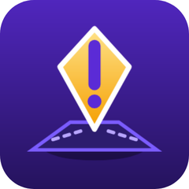

# GameRoute

**Navigation for Android and Android Auto that looks like a video-game minimap.**

Live traffic · spoken directions in English and Greek · drive together in a convoy · 8 game-inspired map styles

[Features](#-features) · [Convoy](#-convoy) · [Android Auto](#-android-auto) · [Map styles](#-map-styles) · [Install](#-install) · [Privacy](#-privacy)

---

## ✨ Features

<table>
<tr>
<td width="33%" valign="top" align="center">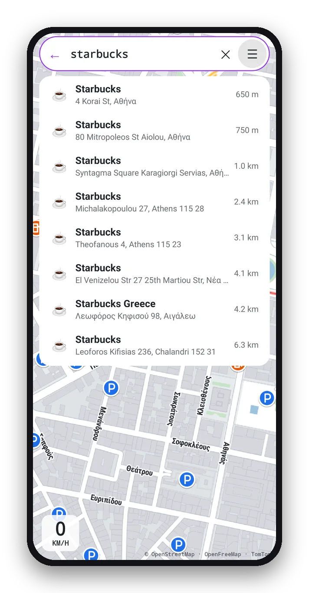</td>
<td width="33%" valign="top" align="center">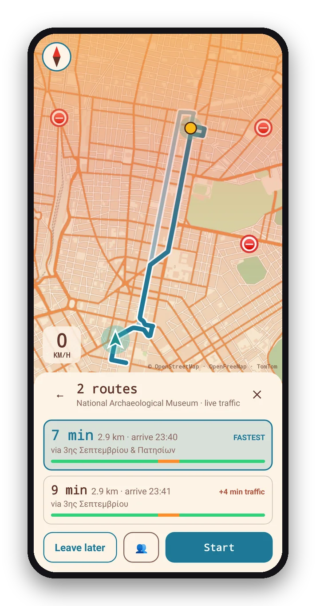</td>
<td width="33%" valign="top" align="center">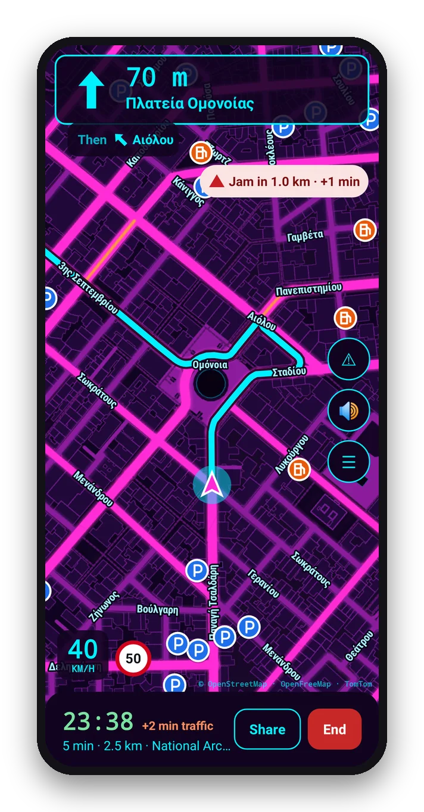</td>
</tr>
<tr>
<td valign="top"><h3>🔎 Find anything</h3>Shops, cafés and businesses from TomTom, OpenStreetMap and Overture Maps (nearly half a million places in Greece and Cyprus), searched together and ranked by how well the name fits, then by distance. Type in Greek, English or Greeklish ("κρεπα λαντ", "crepaland glyfada"), add a town to search there, or open any Google Maps, Apple Maps, Waze or OpenStreetMap link with GameRoute.</td>
<td valign="top"><h3>🛣️ Pick a route</h3>Up to three routes, each timed with live traffic, with a bar that shows where the jams are and the toll cost for the trip. "Leave later" times another departure.</td>
<td valign="top"><h3>🧭 Drive</h3>A big turn card with lanes and "Then…", your speed next to the limit, jam and toll warnings, and an arrival time that counts traffic. Take another street and a new route comes within seconds. In tunnels the arrow keeps moving along the route.</td>
</tr>
<tr>
<td valign="top" align="center">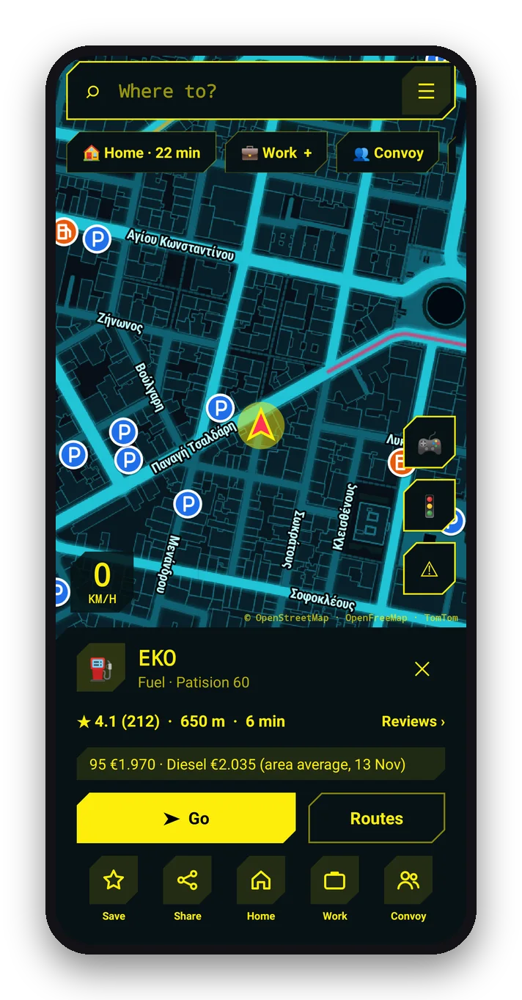</td>
<td valign="top" align="center">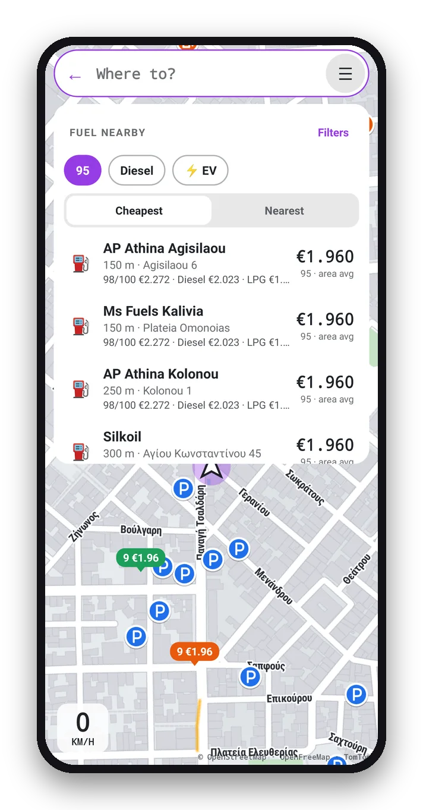</td>
<td valign="top" align="center">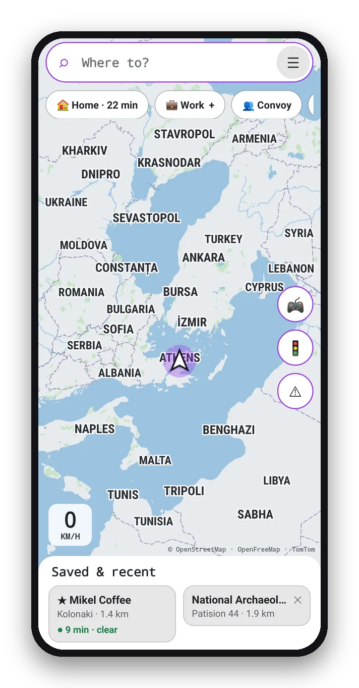</td>
</tr>
<tr>
<td valign="top"><h3>📍 Places on the map</h3>Fuel, parking, food, cafés, pharmacies and supermarkets show as icons on the streets. Tap one for <b>Go</b>, routes, save, share, or Home/Work. Hold anywhere to drop a pin with its address.</td>
<td valign="top"><h3>⛽ Fuel by price</h3>Stations sorted by price for the fuels you use, with prices on the map pins. EV chargers can be filtered by plug type and power, and stations by brand. Add a fuel stop without ending the trip.</td>
<td valign="top"><h3>🌍 The bigger picture</h3>Zoom out to the whole continent, with country borders and names in your language. Download the area around you for offline maps.</td>
</tr>
</table>

### And the small things

- 🚗 **Where I parked:** saved by itself when the phone leaves Android Auto, with walking directions back.
- 💶 **Tolls:** the cost of each route, and a warning before each toll station (Greek motorways).
- 📷 **Alerts:** speed and red-light cameras, accidents and roadworks, each spoken before you reach it.
- ⚡ **Faster routes:** traffic is re-checked as you drive, with one tap to switch when another way saves 3+ minutes.
- 🗣️ **Voice and screens in Ελληνικά or English:** automatic, or chosen in Settings.
- 🏆 **Arrival card:** journey time, distance, time saved and XP, with car parks nearby one tap away.

## 👥 Convoy

<table>
<tr>
<td width="33%" valign="top" align="center">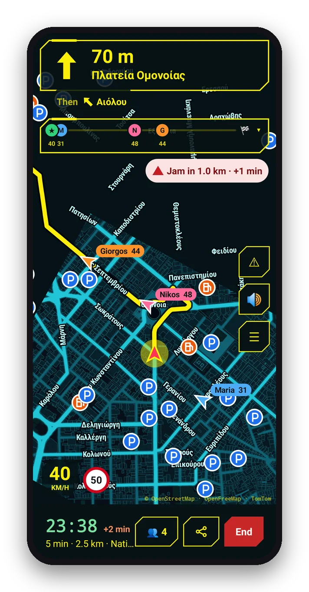</td>
<td width="33%" valign="top" align="center">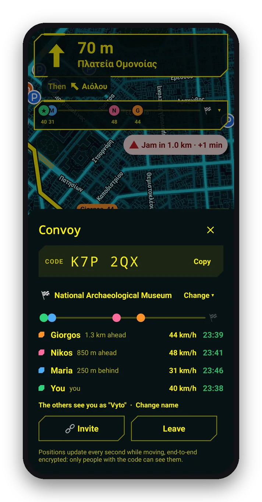</td>
<td width="33%" valign="top" align="center">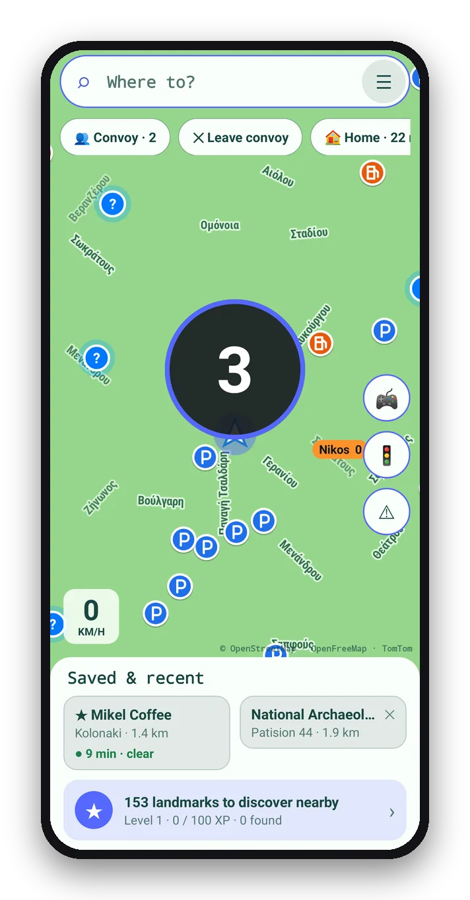</td>
</tr>
<tr>
<td valign="top"><b>See everyone, live.</b> Each friend has their own colour, arrow, name and speed, updated every second and gliding smoothly between updates. Tap a friend to jump to them, or drive to where they are.</td>
<td valign="top"><b>One code, no accounts.</b> Create a convoy, share the 6-letter code or link, and anyone can join. Anyone can choose the destination; the others are asked before their route changes. Anyone can also drive somewhere of their own and still share where they are.</td>
<td valign="top"><b>Race start.</b> Everyone presses <i>I'm ready</i>, a 3-2-1 countdown runs on every phone and car, and the routes start together. Friends without the app can follow on a web page.</td>
</tr>
</table>

Positions are end-to-end encrypted with a key that comes from the code, so only people with the code can read them.

## 🚘 Android Auto

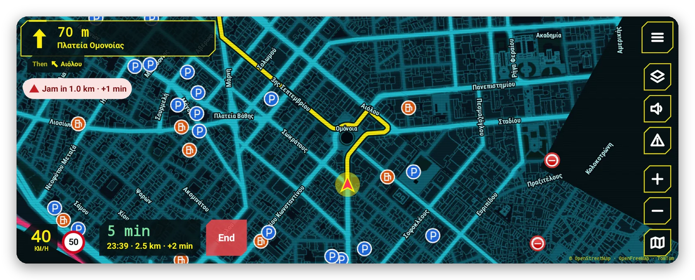

<table>
<tr>
<td width="50%">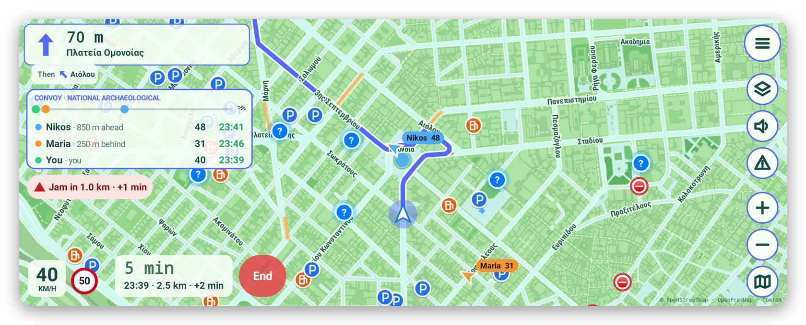</td>
<td width="50%">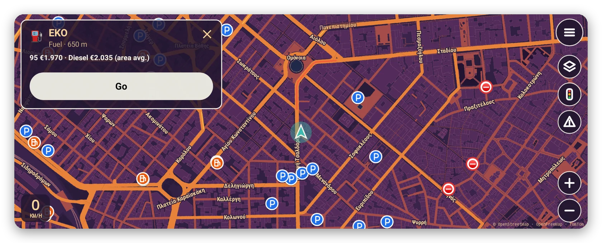</td>
</tr>
</table>

The same map on the car screen, with its own buttons drawn see-through on the map. The turn card sits small in a corner. The convoy box shows everyone's place and arrival time. Tap a fuel station or car park on the map and go. The car has its own map and style, the map can turn dark with your headlights, and convoy prompts (Ready, a new destination) work right on the car screen.

## 🎨 Map styles

Original designs in the spirit of different game genres. Each has a light and a dark version, or switches by itself at sunset.

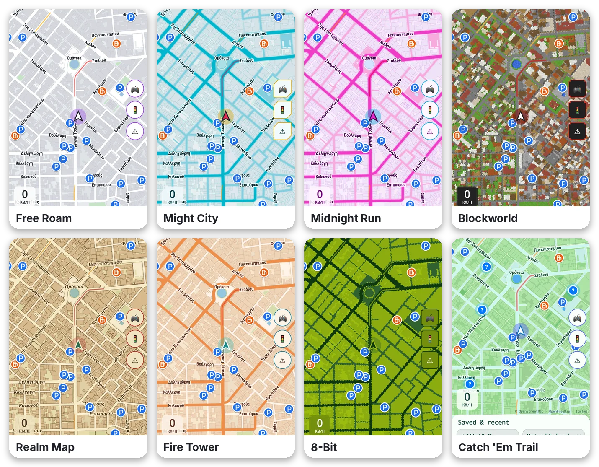

<b>Dark versions</b>

 
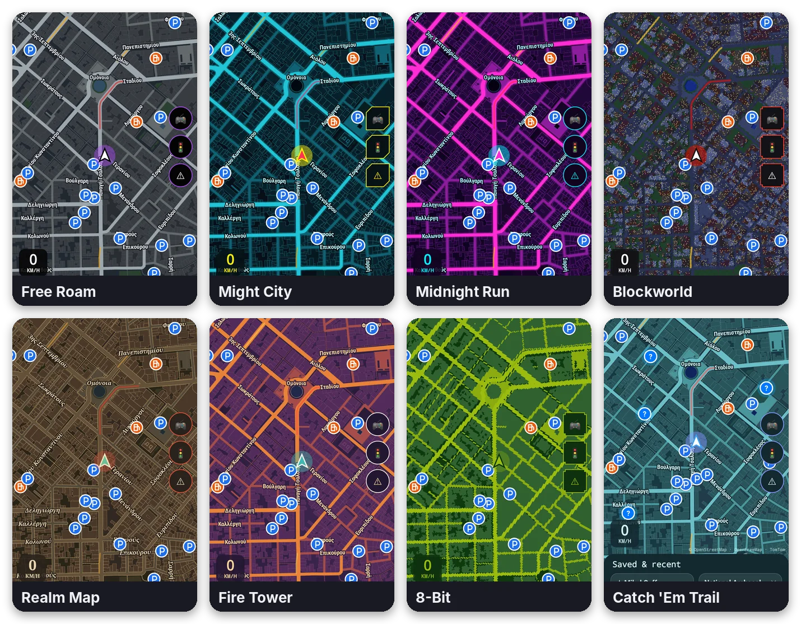

| Style | Feel |
|---|---|
| **Free Roam** | Asphalt-grey streets, slate water, a purple route |
| **Might City** | Teal megacity grid, yellow route, cut-corner panels |
| **Midnight Run** | Neon roads with a grid and horizon glow |
| **Blockworld** | A block world built from the real buildings |
| **Realm Map** | Old paper map, ink roads, a red dashed route |
| **Fire Tower** | Dusk colours from purple to sunset orange |
| **8-Bit** | Handheld-console greens and pixel panels |
| **Catch 'Em Trail** | A bright outdoor look, with landmarks to collect (+25 XP each) |

<table>
<tr>
<td width="33%" align="center">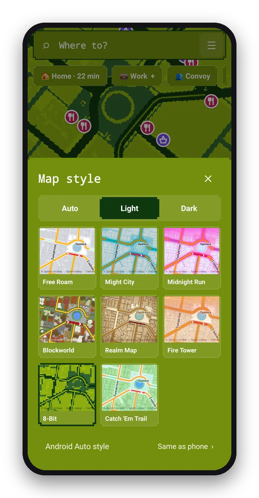</td>
<td width="33%" align="center">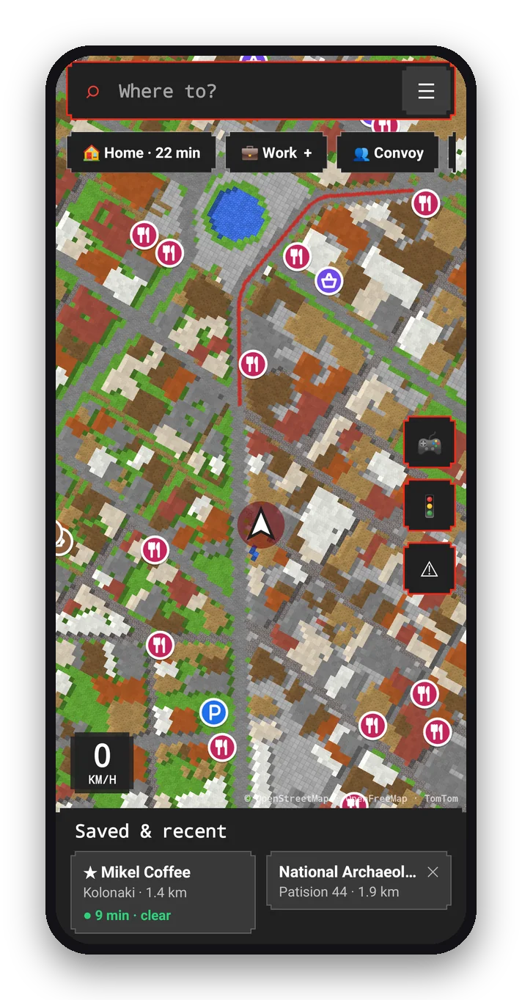</td>
<td width="33%" align="center">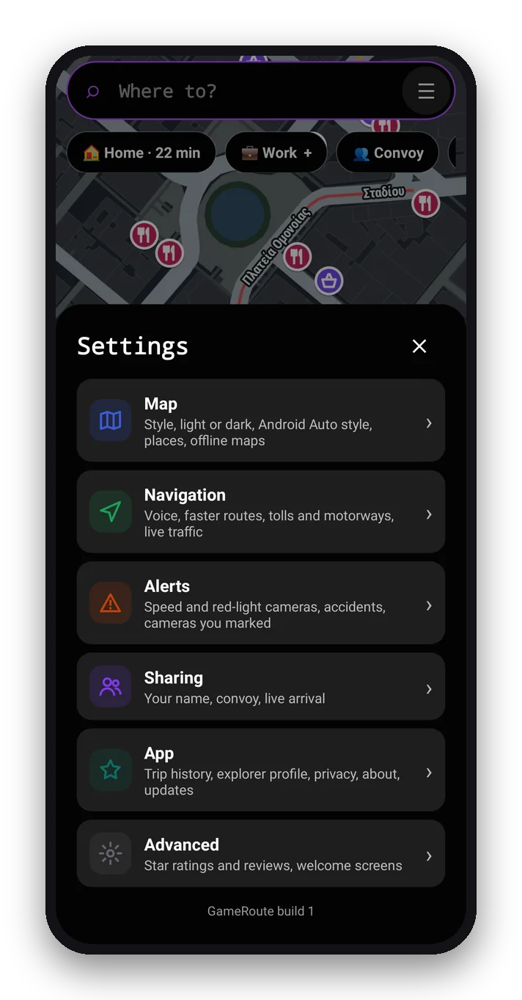</td>
</tr>
</table>

## 📲 Install

Android Auto only shows apps it believes came from Google Play, so GameRoute is installed with **UnknownAuto**:

1. Android Auto settings ▸ tap **Version** 10 times ▸ ⋮ ▸ Developer settings ▸ **Unknown sources**: on.
2. Install **Shizuku** (Play Store) and **UnknownAuto** ([github.com/GitMag/UnknownAuto](https://github.com/GitMag/UnknownAuto)).
3. Start Shizuku (Wireless debugging, or the `adb shell` command it shows, from a computer).
4. Download `GameRoute.apk` from the [latest release](../../releases/latest).
5. UnknownAuto ▸ Load `GameRoute.apk` ▸ **Install** ▸ allow Shizuku ▸ confirm (it shows ✔).
6. Open GameRoute on the phone once and allow location.
7. Restart the phone, connect to the car and open **GameRoute** from the app list.

**Updates:** GameRoute checks for a new release every few hours (or tap Settings ▸ App ▸ Check for updates). It downloads the update and hands it to UnknownAuto: have Shizuku running and tap Install. Every build is signed with the same key, so new versions install over old ones.

## 🔒 Privacy

No account and no tracking. Your trips, places and settings stay on your phone. Searches and routes go to the services listed below. Convoy and live-arrival positions are end-to-end encrypted before they leave the phone. Full details: [privacy page](https://vyto-line.github.io/GameRoute/privacy/).

## 🛠️ Build

Actions ▸ **Build APK** ▸ Run workflow. Each build becomes a release with `GameRoute.apk`.
Kotlin, Android Car App Library 1.4, no Google Play services: the map drawing, routing and search are all done in the app.
The pictures on this page are the app's own screens, drawn by `ReadmeShotsTest` and framed by `tools/readme_images.py`.

## 🙏 Credits

Map data © [OpenStreetMap](https://www.openstreetmap.org/copyright) contributors · vector tiles by [OpenFreeMap](https://openfreemap.org) ·
places by [Overture Maps](https://overturemaps.org) · live traffic, incidents, speed limits and search by [TomTom](https://developer.tomtom.com) ·
routing by [OSRM](https://project-osrm.org) · search by Photon and Nominatim · fuel prices by [fuel-prices.eu](https://www.fuel-prices.eu) ·
convoy relays: ntfy.sh, EMQX and HiveMQ public brokers · star ratings and reviews (optional, your own key) by Google Places.
These are free services: please keep use personal and moderate.

> ⚠️ Keep your eyes on the road. Set your destination before you drive, and follow local laws about speed camera alerts.
