

# 🎮 GameRoute

**Turn-by-turn navigation for Android and Android Auto that looks like a video-game minimap.**

Formerly GameMap.

Live traffic · lane guidance · spoken directions · speed & red-light cameras · places on the map · fuel prices · collectible landmarks · 8 game-inspired map styles

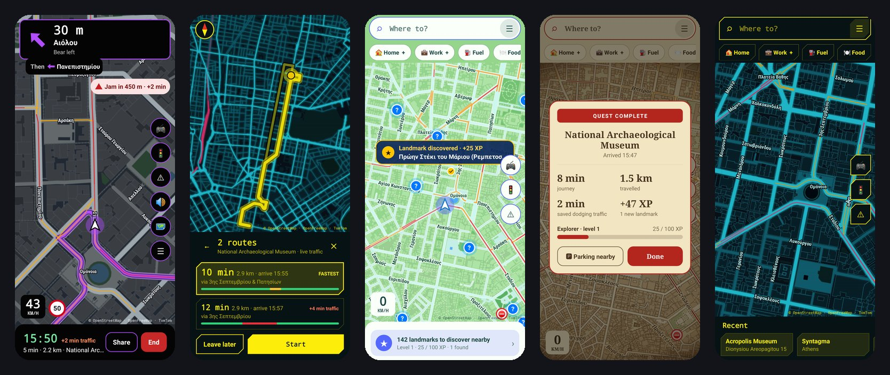

---

## ✨ What it does

<table>
<tr>
<td width="33%" valign="top">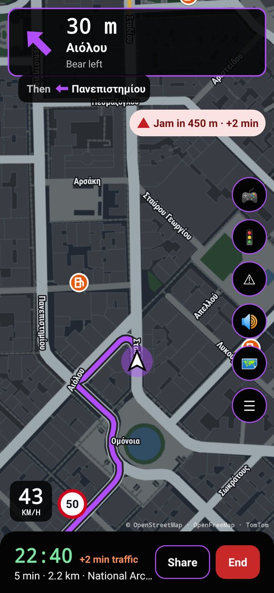 
<b>🧭 Drive</b> Big turn card with the next turn, lane arrows at junctions, your speed next to the speed limit, jam warnings and an arrival time that counts traffic. Drag the map any time; recenter brings you back.</td>
<td width="33%" valign="top">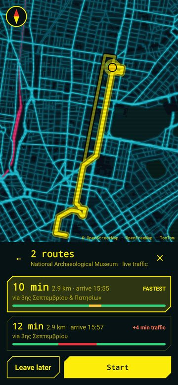 
<b>🛣️ Pick a route</b> Up to three routes, each timed with live traffic and a bar showing where the jams are. "Leave later" shows the time for another departure.</td>
<td width="33%" valign="top">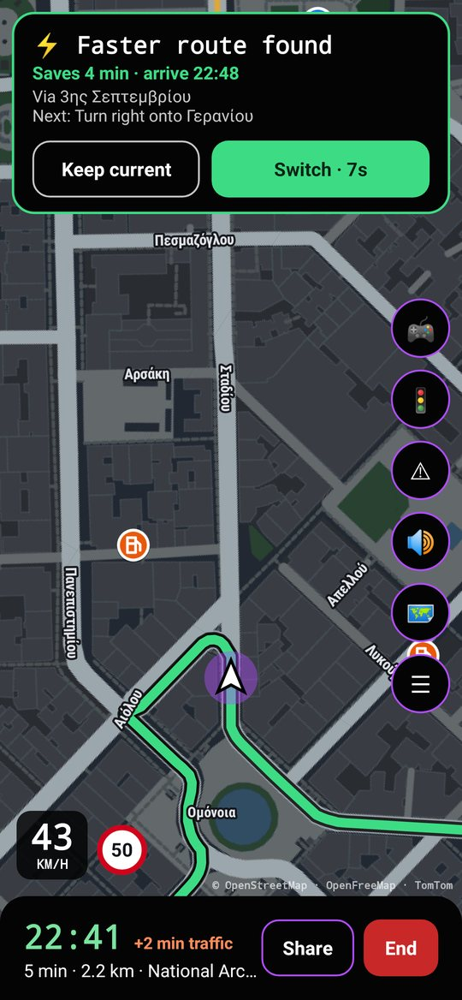 
<b>⚡ Faster routes</b> Traffic is re-checked as you drive. When another way saves 3+ minutes you get Switch / Keep, or it switches by itself. Leave the route and the new one carries on the way you're going.</td>
</tr>
<tr>
<td valign="top">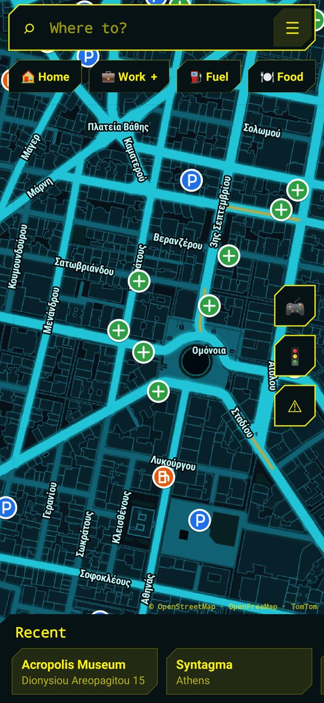 
<b>🏠 Search</b> Results as you type, nearest first. Greek or English, even Greek typed in Latin letters ("eggeli 32" finds Έγγελη 32), exact house numbers, and Home / Work / Fuel / Food / Parking one tap away.</td>
<td valign="top">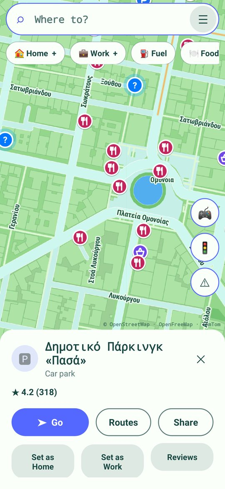 
<b>📍 Places on the map</b> Fuel, parking, food, cafés, pharmacies and supermarkets appear as icons at street level. Tap one for its card: <b>Go</b>, compare routes, share, ratings and reviews.</td>
<td valign="top">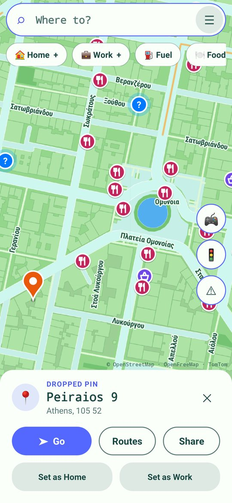 
<b>📌 Tap and hold</b> Hold anywhere on the map to drop a pin. You get the street address, distance and time, and can go there, set it as Home or Work, or share it.</td>
</tr>
<tr>
<td valign="top">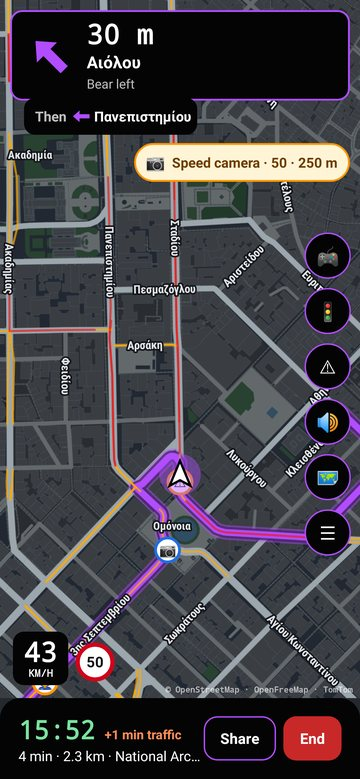 
<b>📷 Alerts</b> Speed and red-light cameras from OpenStreetMap (refreshed every week), accidents and roadworks from TomTom, each with a spoken warning before you reach it.</td>
<td valign="top">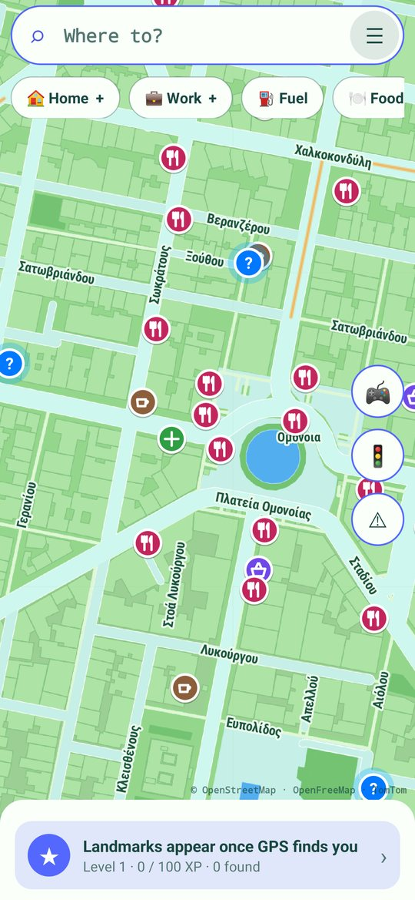 
<b>⛽ Fuel prices & parking</b> Fuel stations show their prices (in Greece the official area average of the day). Parking near your destination is ready before you arrive.</td>
<td valign="top">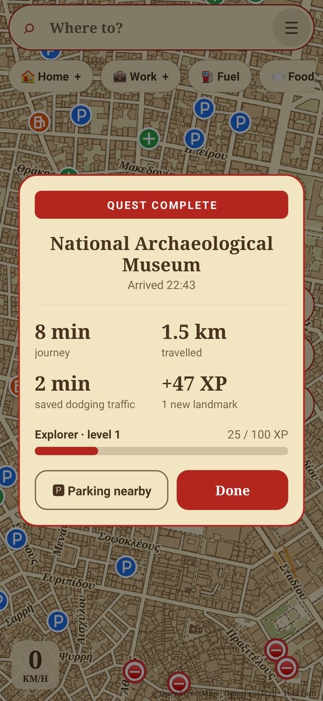 
<b>🏆 Arrive in style</b> Every trip ends with a themed card: journey time, distance, time saved, XP and your explorer level, with a one-tap list of car parks nearby.</td>
</tr>
<tr>
<td valign="top">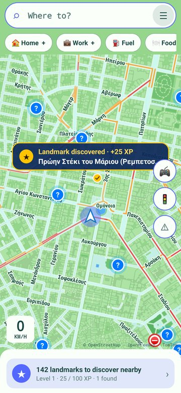 
<b>⭐ Collect landmarks</b> In the Catch 'Em Trail style, museums, monuments and viewpoints show as blue <b>?</b> markers. Pass by one to discover it (+25 XP).</td>
<td valign="top">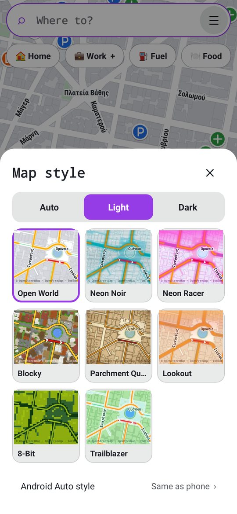 
<b>🎨 Your look</b> Eight styles, each with light, dark or automatic sunset switching. Panels and buttons take the shape of each style.</td>
<td valign="top">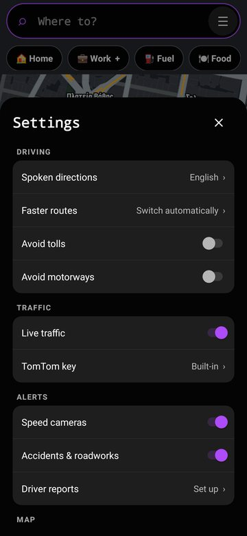 
<b>⚙️ Settings</b> Voice in English or Ελληνικά, avoid tolls or motorways, traffic on/off, which alerts you want, places on the map, kilometres or miles, and a separate style for the car.</td>
</tr>
</table>

## 🚗 On the car screen

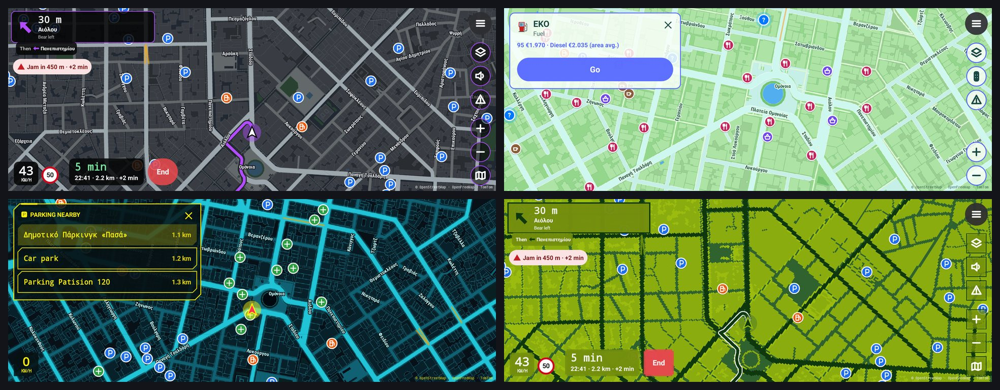

The same map on Android Auto, with its own buttons drawn see-through on the map: menu, style, voice, alerts, zoom and recenter. The turn card sits small in the top-left corner with lanes and "Then…". Tap a fuel station or car park on the map and go. After you arrive, the nearest car parks are one tap away. The car has its own map, so moving it never moves the one on your phone. The map turns dark when you switch on your headlights (a setting), and GameRoute lightens its drawing by itself if a phone struggles to keep up.

## 🗺️ Map styles

Original designs in the spirit of different game genres. Each comes in a light and a dark version.

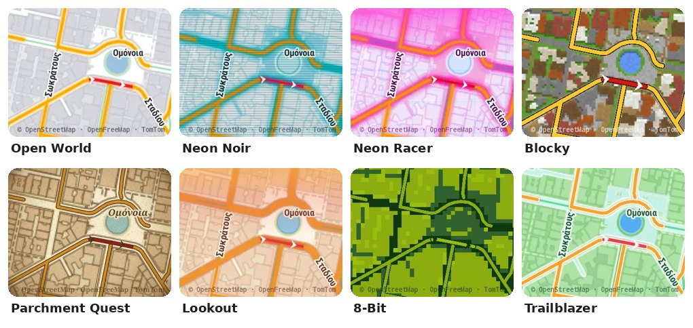

| Style | Feel |
|---|---|
| **Free Roam** | Asphalt-grey streets, slate water, purple GPS line |
| **Night City** | Teal megacity grid, yellow route, cut-corner panels, scanlines |
| **Midnight Run** | Neon roads, grid and horizon glow |
| **Blockworld** | A block world built from real buildings: planks, bricks, stone and terracotta roofs |
| **Realm Map** | Old paper map, ink roads, red dashed route, serif lettering |
| **Fire Tower** | Dusk palette from purple to sunset orange |
| **8-Bit** | Handheld-console greens and pixel panels |
| **Catch 'Em Trail** | Bright outdoor-adventure look, with landmarks to collect |

Dark versions

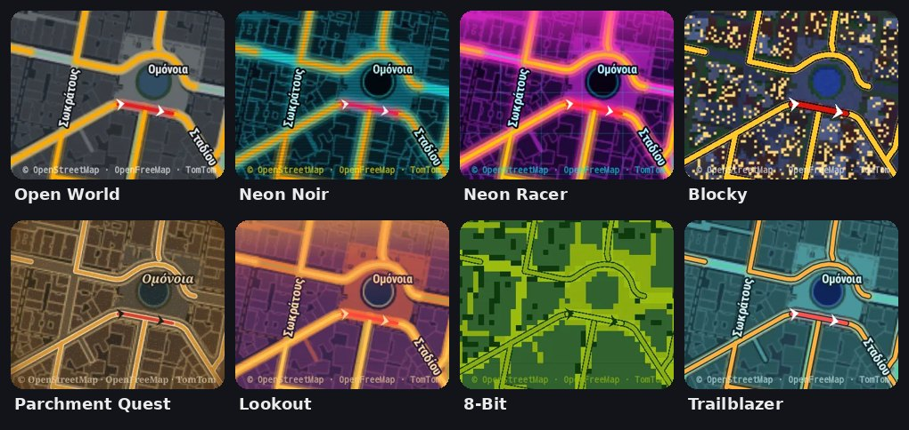

## 📲 Install

Android Auto only shows apps it believes came from Google Play, so GameRoute is installed with **UnknownAuto**:

1. Android Auto settings ▸ tap **Version** 10× ▸ ⋮ ▸ Developer settings ▸ **Unknown sources**: ON.
2. Install **Shizuku** (Play Store) and **UnknownAuto** (github.com/GitMag/UnknownAuto).
3. Start Shizuku (Wireless debugging, or the `adb shell …libshizuku.so` command from a computer).
4. Download `GameRoute.apk` from the [latest release](../../releases/latest).
5. UnknownAuto ▸ Load `GameRoute.apk` ▸ **Install** ▸ allow Shizuku ▸ confirm. It should show ✔.
6. Open GameRoute on the phone once and allow location.
7. Restart the phone, connect to the car and open **GameRoute** from the app list.

Every build is signed with the same key, so new versions install over old ones.

## 🔄 Updates

GameRoute checks for a new release every few hours, or when you tap **Settings ▸ Check for updates**.
It downloads the update and opens it in UnknownAuto: have Shizuku running and tap Install, so GameRoute stays visible in Android Auto.
The car screen shows a notice when an update is ready.

## 🛠️ Build

Actions ▸ **Build APK** ▸ Run workflow, or push a tag like `v1.1`. Each build becomes a release with `GameRoute.apk`.
Kotlin, Android Car App Library 1.4, no Google Play services. Map drawing, routing and search are all done in the app.

## 🙏 Credits

Map data © [OpenStreetMap](https://www.openstreetmap.org/copyright) contributors · vector tiles by [OpenFreeMap](https://openfreemap.org) ·
live traffic, incidents and speed limits by [TomTom](https://developer.tomtom.com) · routing by [OSRM](https://project-osrm.org) ·
search by TomTom and Nominatim · fuel prices by [fuel-prices.eu](https://www.fuel-prices.eu) ·
star ratings and reviews (optional, your own key) by Google Places. Free services: please keep use personal and moderate.

> ⚠️ Keep your eyes on the road. Set your destination before you drive, and follow local laws about speed camera alerts.
